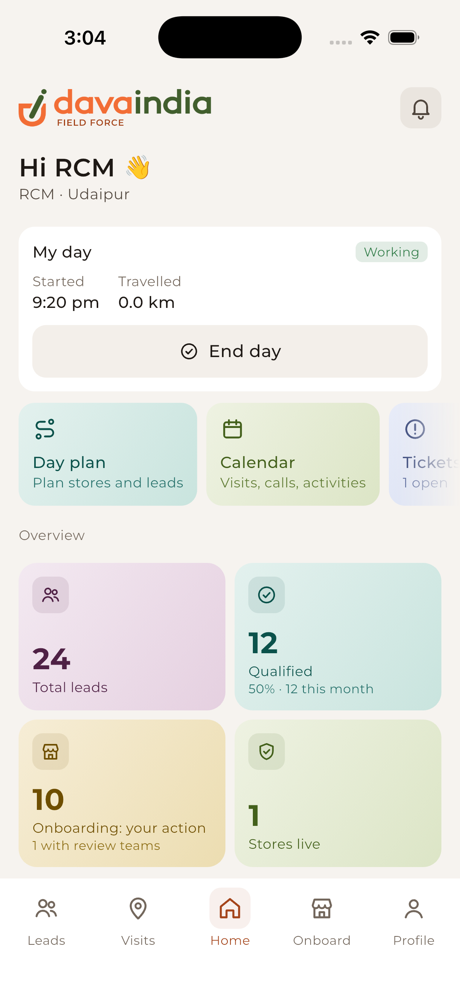
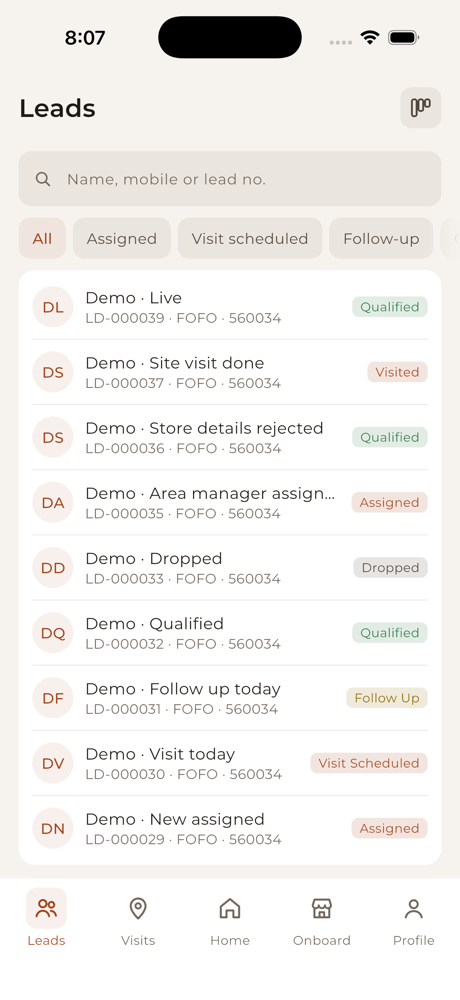
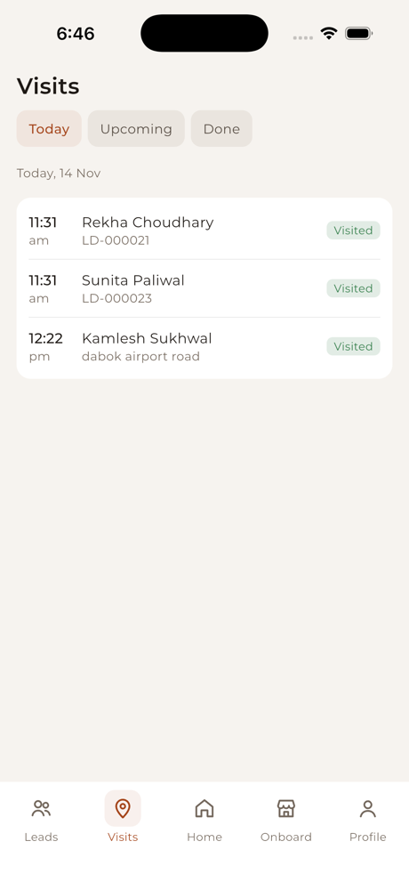

# Davaindia Field Force

The mobile app Dava India field staff use to bring new FOFO and COCO pharmacy stores on board.

A field user (an RCM today, other designations later) signs in, works the leads assigned to them, visits the site and takes the partner through onboarding: store details, owner KYC and licences, the offline franchise fee transfer and the drug licence. Ops, finance and compliance review each step in the CRM admin. What each user can see and do comes from permissions set in the CRM, not from the app.

[](https://github.com/Zota-DavaIndia/fofo-business-onboarding-mobile/actions/workflows/ci.yml)
[](https://github.com/Zota-DavaIndia/fofo-business-onboarding-mobile/actions/workflows/release.yml)


## Contents

- [Download](#download)
- [Screenshots](#screenshots)
- [Features](#features)
- [Getting started](#getting-started)
- [Releasing](#releasing)
- [Project structure](#project-structure)
- [Contributing](#contributing)
- [License](#license)
- [Contact](#contact)

## Download

| Platform | Download | Requires |
|---|---|---|
| Android | [davaindia-ff-android.apk](https://github.com/Zota-DavaIndia/fofo-business-onboarding-mobile/releases/latest/download/davaindia-ff-android.apk) (latest) · [all releases](https://github.com/Zota-DavaIndia/fofo-business-onboarding-mobile/releases) | Android 7.0 or newer |
| iOS | Not distributed yet. [Build from source](#getting-started) | |

The APK link always downloads the newest release. Each release includes `SHA256SUMS` for checking the download. When installing the APK, Android asks you to allow installs from your browser or file manager the first time; after that the app finds and installs updates itself.

## Screenshots

| Home | Home, dark | Leads | Visits | Profile |
|---|---|---|---|---|
|  |  |  |  |  |

Taken on the staging server with a test field account.

## Features

Built so far:

- Sign-in with email or mobile, then password, with the phone's device ID sent for admin approval.
- Enquiry tracking: someone who applied signs in with their mobile and a code and sees where their application stands.
- Opens offline using the last signed-in session.
- Bottom tabs (Leads, Visits, Home, Onboard, Profile) shown according to the user's permissions; alerts open from the bell on Home.
- Home with greeting, territory, lead counts and today's visits. Tapping a count opens Leads on that list.
- Leads: search by name, mobile or lead number, filter by status, and open a lead to see contact details, the call centre's notes, shop details, onboarding progress and the timeline.
- Lead actions: call, log a call, add a note, change status or close with a reason, edit details, reassign, and add a walk-in lead. Each shows only when the user's permissions and the lead's state allow it.
- Visits: today, upcoming and done lists; schedule, reschedule and cancel; check in with GPS distance to the shop, mock-location detection, a photo and the site assessment; check out as qualified, follow-up, not qualified or dropped.
- Lead page with everything the CRM shows: stage and time in it, source and campaign, RCM and territory, calls made, consent, timeline, all sources, and a map of the lead and the proposed store with directions in Google Maps.
- My day: start and end the working day with a real GPS fix (mock locations refused); while it runs the route is recorded, in the background too, and sent in batches that wait out a lost connection.
- Expenses: claims by station (HQ, Ex-HQ, Outstation) and type, travel mode and km, receipt photo above a set amount; drafts are edited, then submitted for the manager's approval.
- Leave: casual, sick, earned or unpaid, half days, days taken this year, and cancelling before it starts.
- Day plan with a map of today's stores and leads; store check-in and check-out with a summary; store tickets followed to resolution; a calendar of visits, callbacks, follow-ups, plans, leave and scheduled activities.
- Coordinates only ever come from the phone's GPS; there are no typed or hand-picked locations.
- Live alerts while the app is open: a 15-second check refreshes what a new alert touched and shows a toast that opens it. Push notifications for a closed app are built in and turn on with the Firebase settings below.
- Updates on Android: the app checks GitHub Releases at launch and every 6 hours. When a newer release is out it opens the update screen once for that version (Home and Profile keep offering it); the app downloads the APK, checks its SHA-256 against the release and opens the installer.
- Profile tab with contact details, app version, a copyable device ID and sign out.
- Light and dark themes that follow the phone setting.
- Custom icon set drawn from SVG sources, with no icon font or SVG library.
- Launcher icon: davaindia with an italic "ff" (field force) under it on clay. Inside the app, the logo is the official davaindia icon and word, with "FIELD FORCE" in clay caps under the word. Both built by `scripts/app_icon/generate.py`.
- Montserrat, bundled with the app.

Planned next: store sales reports once the ERP is connected.

## Getting started

Requirements: Flutter 3.44 or newer (stable) and Xcode with an iOS simulator.

```bash
flutter pub get
```

Run against the staging CRM:

```bash
flutter run --dart-define-from-file=env/staging.json
```

Run against a local CRM backend:

```bash
cp env/example.json env/local.json
```

Set `API_BASE_URL` in `env/local.json`, then:

```bash
flutter run --dart-define-from-file=env/local.json
```

Maps use a Google Maps key that stays out of git: put `MAPS_API_KEY = …` in `ios/Flutter/Secrets.xcconfig` and `MAPS_API_KEY=…` in `android/local.properties`, and add `"MAPS_ENABLED": true` to your env file. Without it, map cards fall back to an "open in Google Maps" link. Release builds read the `MAPS_API_KEY` repository secret.

Push notifications use Firebase without config files: pass `FIREBASE_API_KEY`, `FIREBASE_PROJECT_ID`, `FIREBASE_SENDER_ID` and `FIREBASE_ANDROID_APP_ID` (and `FIREBASE_IOS_APP_ID`) as dart-defines, or the repository secrets of the same names for releases. Without them push stays off. iOS push also needs the Push Notifications capability and an APNs key in Firebase.

Check the code:

```bash
dart format lib test scripts
flutter analyze
flutter test
```

After adding or changing an SVG in `assets/icons/`, regenerate the icon code:

```bash
dart run scripts/gen_icons.dart
```

To rebuild the app icon and the "ff" mark (needs `pip install fonttools uharfbuzz`, `rsvg-convert` and ImageMagick):

```bash
python3 scripts/app_icon/generate.py
```

## Releasing

Android builds are made only by GitHub Actions.

1. Bump `version` in `pubspec.yaml`, for example `1.1.0+2`.
2. Merge to `main`.

The release workflow then tests, builds and signs the APK, checks the signature, tags `v1.1.0` and publishes the APK, `version.json` and `SHA256SUMS`. Installed apps read `version.json` to find the update; the build number is passed as `APP_BUILD`, so a rebuild of the same version is offered too. It needs these repository settings:

| Name | Kind | Purpose |
|---|---|---|
| `ANDROID_KEYSTORE_BASE64` | secret | Release keystore, base64 encoded |
| `ANDROID_KEYSTORE_PASSWORD` | secret | Keystore password |
| `ANDROID_KEY_ALIAS` | secret | Key alias |
| `ANDROID_KEY_PASSWORD` | secret | Key password |
| `FIREBASE_API_KEY`, `FIREBASE_PROJECT_ID`, `FIREBASE_SENDER_ID`, `FIREBASE_ANDROID_APP_ID` | secrets | Firebase project for push notifications. Without them, releases have no push and rely on live alerts while open |
| `MAPS_API_KEY` | secret | Google Maps key for the in-app maps. Without it, release builds show "open in Google Maps" links instead |
| `API_BASE_URL` | variable | Production CRM API address baked into release builds. Until it's set, releases use the staging API from `env/staging.json` |

## Project structure

```
lib/
  app/          app widget, router, tab shell, list of modules
  core/         theme tokens, icons, API client, session, shared widgets
  features/     one folder per area: auth, home, leads, visits, onboarding, profile, alerts
assets/icons/   SVG sources for the icon set
assets/brand/   davaindia lettering from the official logo (light and dark, 1x to 3x)
assets/fonts/   Montserrat (SIL Open Font License)
assets/emoji/   waving hand from Noto Emoji by Google (Apache License 2.0)
scripts/        icon set and app icon generators
test/           unit and widget tests
env/            build settings for staging and local runs
```

## Contributing

See [CONTRIBUTING.md](CONTRIBUTING.md) for setup, conventions and the pull request flow. Everyone involved follows the [code of conduct](CODE_OF_CONDUCT.md). Report security problems privately as described in [SECURITY.md](SECURITY.md).

## License

Proprietary. The source is public only so release builds can be downloaded. See [LICENSE](LICENSE).

The waving hand image in `assets/emoji` is from [Noto Emoji](https://github.com/googlefonts/noto-emoji) by Google, used under the [Apache License 2.0](https://www.apache.org/licenses/LICENSE-2.0).

## Contact

Maintained by [@besaoct](https://github.com/besaoct).
