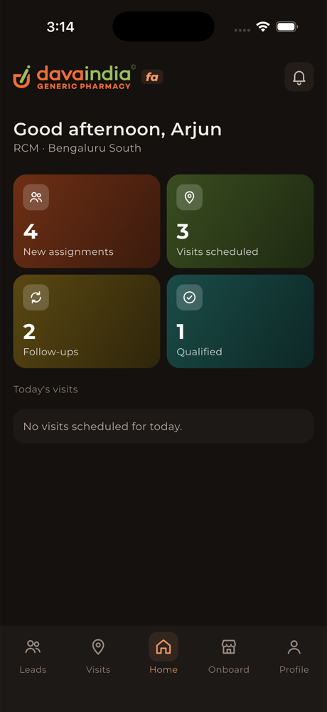

# Davaindia Field

The mobile app Dava India field staff use to bring new FOFO and COCO pharmacy stores on board.

A field user (an RCM today, other designations later) signs in, works the leads assigned to them, visits the site and takes the partner through onboarding: store details, owner KYC and licences, the offline franchise fee transfer and the drug licence. Ops, finance and compliance review each step in the CRM admin. What each user can see and do comes from permissions set in the CRM, not from the app.

[](https://github.com/Zota-DavaIndia/fofo-business-onboarding-mobile/actions/workflows/ci.yml)
[](https://github.com/Zota-DavaIndia/fofo-business-onboarding-mobile/actions/workflows/release.yml)


## Contents

- [Screenshots](#screenshots)
- [Features](#features)
- [Download](#download)
- [Getting started](#getting-started)
- [Releasing](#releasing)
- [Project structure](#project-structure)
- [Contributing](#contributing)
- [License](#license)
- [Contact](#contact)

## Screenshots

| Home | Home, dark | Profile |
|---|---|---|
|  |  |  |

Taken in demo mode with sample data.

## Features

Built so far:

- Email and password sign-in, with the phone's device ID sent for admin approval.
- Opens offline using the last signed-in session.
- Bottom tabs (Leads, Visits, Home, Onboard, Profile) shown according to the user's permissions; alerts open from the bell on Home.
- Home with greeting, territory and lead counts as gradient cards.
- Profile tab with contact details, app version, a copyable device ID and sign out.
- Light and dark themes that follow the phone setting.
- Custom icon set drawn from SVG sources, with no icon font or SVG library.
- The official Dava India logo with an "fa" tag inside the app; the launcher icon is generated from vector outlines by `scripts/app_icon/generate.py`.
- Montserrat, bundled with the app.
- Demo mode that answers the API with sample data.

Planned next: the lead list and detail, visit scheduling with GPS check-in, the onboarding steps, payment recording, push notifications, and the in-app updater that installs new versions from GitHub Releases.

## Download

| Platform | File | Requires |
|---|---|---|
| Android | `davaindia-field-android.apk` from the [latest release](https://github.com/Zota-DavaIndia/fofo-business-onboarding-mobile/releases/latest) | Android 7.0 or newer |
| iOS | Not distributed yet. [Build from source](#getting-started) | |

The first release will be published once the production CRM address is configured. Each release includes `SHA256SUMS` for checking the download. When installing the APK, Android asks you to allow installs from your browser or file manager the first time.

## Getting started

Requirements: Flutter 3.44 or newer (stable) and Xcode with an iOS simulator.

```bash
flutter pub get
```

Try the app with sample data, no backend needed:

```bash
flutter run --dart-define-from-file=env/demo.json
```

Any email and password signs in.

Run against a CRM backend:

```bash
cp env/example.json env/local.json
```

Set `API_BASE_URL` in `env/local.json`, then:

```bash
flutter run --dart-define-from-file=env/local.json
```

Check the code:

```bash
dart format lib test scripts
flutter analyze
flutter test
```

After adding or changing an SVG in `assets/icons/`, regenerate the icon code:

```bash
dart run scripts/gen_icons.dart
```

To rebuild the app icon and the "fa" tag (needs `pip install fonttools uharfbuzz`, `rsvg-convert` and ImageMagick):

```bash
python3 scripts/app_icon/generate.py
```

## Releasing

Android builds are made only by GitHub Actions.

1. Bump `version` in `pubspec.yaml`, for example `0.2.0+2`.
2. Merge to `main`.

The release workflow then tests, builds and signs the APK, checks the signature, tags `v0.2.0` and publishes the APK, `version.json` and `SHA256SUMS`. It needs these repository settings:

| Name | Kind | Purpose |
|---|---|---|
| `ANDROID_KEYSTORE_BASE64` | secret | Release keystore, base64 encoded |
| `ANDROID_KEYSTORE_PASSWORD` | secret | Keystore password |
| `ANDROID_KEY_ALIAS` | secret | Key alias |
| `ANDROID_KEY_PASSWORD` | secret | Key password |
| `API_BASE_URL` | variable | CRM API address baked into the release build; releases are skipped until it's set |

## Project structure

```
lib/
  app/          app widget, router, tab shell, list of modules
  core/         theme tokens, icons, API client, session, shared widgets
  features/     one folder per area: auth, home, leads, visits, onboarding, profile, alerts
assets/icons/   SVG sources for the icon set
assets/brand/   Dava India logo (light and dark, 1x to 3x)
assets/fonts/   Montserrat (SIL Open Font License)
scripts/        icon set and app icon generators
test/           unit and widget tests
env/            build settings for demo and local runs
```

## Contributing

See [CONTRIBUTING.md](CONTRIBUTING.md) for setup, conventions and the pull request flow. Everyone involved follows the [code of conduct](CODE_OF_CONDUCT.md). Report security problems privately as described in [SECURITY.md](SECURITY.md).

## License

Proprietary. The source is public only so release builds can be downloaded. See [LICENSE](LICENSE).

## Contact

Maintained by [@besaoct](https://github.com/besaoct).
