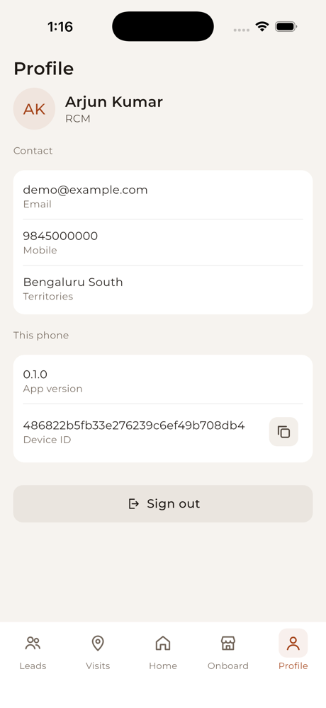

# Davaindia Field Force

The mobile app Dava India field staff use to bring new FOFO and COCO pharmacy stores on board.

A field user (an RCM today, other designations later) signs in, works the leads assigned to them, visits the site and takes the partner through onboarding: store details, owner KYC and licences, the offline franchise fee transfer and the drug licence. Ops, finance and compliance review each step in the CRM admin. What each user can see and do comes from permissions set in the CRM, not from the app.

[](https://github.com/Zota-DavaIndia/fofo-business-onboarding-mobile/actions/workflows/ci.yml)
[](https://github.com/Zota-DavaIndia/fofo-business-onboarding-mobile/actions/workflows/release.yml)


## Contents

- [Screenshots](#screenshots)
- [Features](#features)
- [Download](#download)
- [Getting started](#getting-started)
- [Releasing](#releasing)
- [Project structure](#project-structure)
- [Contributing](#contributing)
- [License](#license)
- [Contact](#contact)

## Screenshots

| Home | Home, dark | Leads | Visits | Profile |
|---|---|---|---|---|
|  |  |  |  |  |

Taken on the staging server with a test field account.

## Features

Built so far:

- Sign-in with email or mobile, then password, with the phone's device ID sent for admin approval.
- Enquiry tracking: someone who applied signs in with their mobile and a code and sees where their application stands.
- Opens offline using the last signed-in session.
- Bottom tabs (Leads, Visits, Home, Onboard, Profile) shown according to the user's permissions; alerts open from the bell on Home.
- Home with greeting, territory, lead counts and today's visits. Tapping a count opens Leads on that list.
- Leads: search by name, mobile or lead number, filter by status, and open a lead to see contact details, the call centre's notes, shop details, onboarding progress and the timeline.
- Lead actions: call, log a call, add a note, change status or close with a reason, edit details, reassign, and add a walk-in lead. Each shows only when the user's permissions and the lead's state allow it.
- Visits: today, upcoming and done lists; schedule, reschedule and cancel; check in with GPS distance to the shop, mock-location detection, a photo and the site assessment; check out as qualified, follow-up, not qualified or dropped.
- Profile tab with contact details, app version, a copyable device ID and sign out.
- Light and dark themes that follow the phone setting.
- Custom icon set drawn from SVG sources, with no icon font or SVG library.
- Launcher icon: davaindia with an italic "ff" (field force) under it on clay. Inside the app, the logo is the official davaindia icon and word, with "FIELD FORCE" in clay caps under the word. Both built by `scripts/app_icon/generate.py`.
- Montserrat, bundled with the app.

Planned next: push notifications, the in-app updater that installs new versions from GitHub Releases, and field force tools (expenses, leave, start and end of day, tickets, day plan).

## Download

| Platform | File | Requires |
|---|---|---|
| Android | `davaindia-ff-android.apk` from the [latest release](https://github.com/Zota-DavaIndia/fofo-business-onboarding-mobile/releases/latest) | Android 7.0 or newer |
| iOS | Not distributed yet. [Build from source](#getting-started) | |

The first release will be published once the production CRM address is configured. Each release includes `SHA256SUMS` for checking the download. When installing the APK, Android asks you to allow installs from your browser or file manager the first time.

## Getting started

Requirements: Flutter 3.44 or newer (stable) and Xcode with an iOS simulator.

```bash
flutter pub get
```

Run against the staging CRM:

```bash
flutter run --dart-define-from-file=env/staging.json
```

Run against a local CRM backend:

```bash
cp env/example.json env/local.json
```

Set `API_BASE_URL` in `env/local.json`, then:

```bash
flutter run --dart-define-from-file=env/local.json
```

Check the code:

```bash
dart format lib test scripts
flutter analyze
flutter test
```

After adding or changing an SVG in `assets/icons/`, regenerate the icon code:

```bash
dart run scripts/gen_icons.dart
```

To rebuild the app icon and the "ff" mark (needs `pip install fonttools uharfbuzz`, `rsvg-convert` and ImageMagick):

```bash
python3 scripts/app_icon/generate.py
```

## Releasing

Android builds are made only by GitHub Actions.

1. Bump `version` in `pubspec.yaml`, for example `1.1.0+2`.
2. Merge to `main`.

The release workflow then tests, builds and signs the APK, checks the signature, tags `v1.1.0` and publishes the APK, `version.json` and `SHA256SUMS`. It needs these repository settings:

| Name | Kind | Purpose |
|---|---|---|
| `ANDROID_KEYSTORE_BASE64` | secret | Release keystore, base64 encoded |
| `ANDROID_KEYSTORE_PASSWORD` | secret | Keystore password |
| `ANDROID_KEY_ALIAS` | secret | Key alias |
| `ANDROID_KEY_PASSWORD` | secret | Key password |
| `API_BASE_URL` | variable | Production CRM API address baked into release builds. Until it's set, releases use the staging API from `env/staging.json` |

## Project structure

```
lib/
  app/          app widget, router, tab shell, list of modules
  core/         theme tokens, icons, API client, session, shared widgets
  features/     one folder per area: auth, home, leads, visits, onboarding, profile, alerts
assets/icons/   SVG sources for the icon set
assets/brand/   davaindia lettering from the official logo (light and dark, 1x to 3x)
assets/fonts/   Montserrat (SIL Open Font License)
scripts/        icon set and app icon generators
test/           unit and widget tests
env/            build settings for staging and local runs
```

## Contributing

See [CONTRIBUTING.md](CONTRIBUTING.md) for setup, conventions and the pull request flow. Everyone involved follows the [code of conduct](CODE_OF_CONDUCT.md). Report security problems privately as described in [SECURITY.md](SECURITY.md).

## License

Proprietary. The source is public only so release builds can be downloaded. See [LICENSE](LICENSE).

## Contact

Maintained by [@besaoct](https://github.com/besaoct).
